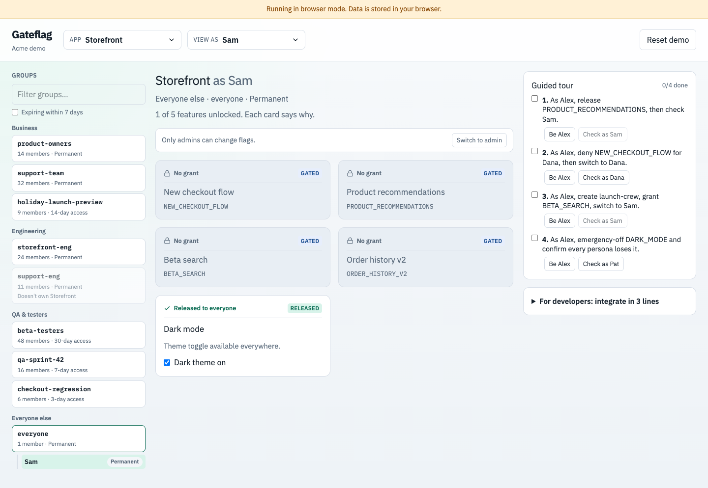
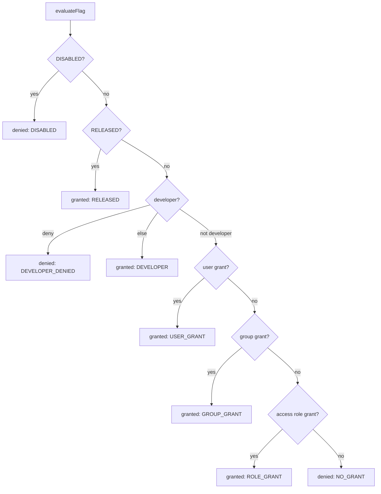
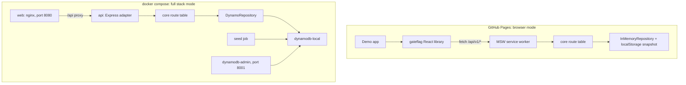

# Gateflag

**Feature flags with a clear three-state model — and a demo that teaches the rules in 60 seconds.**

**Live demo:** [https://9spire.github.io/gateflag/](https://9spire.github.io/gateflag/)

> **GIF to record:** open the Pages demo in browser mode → start as Sam (most cards locked) → pick the `beta-testers` group in the rail (three more cards unlock; each card shows its group / role / user grant reason) → use View as to switch to Alex → click Admin. Export as `docs/screenshots/persona-switch.gif` and drop it here.



## Try it in 30 seconds

1. **Browser-only:** open the [live demo](https://9spire.github.io/gateflag/) (MSW + `localStorage`, no backend).
2. **Full stack:**

```bash
git clone https://github.com/9spire/gateflag.git
cd gateflag
docker compose up --build
# demo http://localhost:8080  ·  Dynamo admin http://localhost:8001
```

## The problem

Product teams need more than on/off toggles: emergency kill switches, selective betas, and automatic access for developers — without each host app reinventing the rules. Gateflag is a portfolio implementation of that model: one evaluator, one admin UI, two runtimes (browser MSW and Express + DynamoDB).

## Three-state model and evaluation order

Every flag has a **universal state**:

| State | Meaning |
|---|---|
| `DISABLED` | Off for everyone, including developers |
| `GATED` | Selective grants (role / group / user) + developer auto-access |
| `RELEASED` | On for everyone |



## Architecture: one route table, two adapters



`@gateflag/core` owns `createRoutes()`. Express and MSW only adapt transport.

## DynamoDB single-table design

| Entity | PK | SK | GSI1PK | GSI1SK |
|---|---|---|---|---|
| User | `USER#<email>` | `METADATA` | `USERS` | `<email>` |
| Flag | `FLAG#<key>` | `METADATA` | `FLAGS` | `<key>` |
| Group | `GROUP#<key>` | `METADATA` | `GROUPS` | `<key>` |
| Role grant | `FLAG#<key>` | `ROLE#access` | | |
| Group grant | `FLAG#<key>` | `GROUP#<groupKey>` | `GROUP#<groupKey>` | `FLAG#<key>` |
| Membership | `USER#<email>` | `GROUP#<groupKey>` | `GROUP#<groupKey>` | `USER#<email>` |
| User grant | `USER#<email>` | `FLAG#<key>` | `FLAG#<key>` | `USER#<email>` |
| Developer deny | `USER#<email>` | `FLAG_DENY#<key>` | `FLAG#<key>` | `DENY#<email>` |
| Audit | `AUDIT` | `<ISO at>#<id>` | | |

| Need | Operation |
|---|---|
| Everything about a user | **one** `Query PK = USER#<email>` |
| List users / flags / groups | `Query GSI1` |
| Flag role + group grants | `Query PK = FLAG#<key>` |
| Flag user grants + denies | `Query GSI1 GSI1PK = FLAG#<key>` |
| Group members + flag grants | `Query GSI1 GSI1PK = GROUP#<key>` |
| Audit page | `Query PK = AUDIT` newest first |

## React integration

```tsx
import {
  AccessControlProvider,
  ProtectedFeature,
  AccessButton,
} from 'gateflag';
import 'gateflag/styles.css';

<AccessControlProvider
  config={{ apiBaseUrl: '', userId, accessClientId: 'storefront' }}
>
  <AccessButton label="Admin" />
  <ProtectedFeature flag="NEW_CHECKOUT_FLOW" fallback={<Locked />}>
    <NewCheckout />
  </ProtectedFeature>
</AccessControlProvider>
```

- Permissions poll (default 30s), refresh on window focus, and refresh when the admin modal closes.
- Errors and identity changes **fail closed** (no grants until the next successful load).
- Published tarball ~38 kB; JS gzip ~10 kB, CSS gzip ~3 kB.

## Auth in this demo

The client sends **`X-Demo-User: <personaId>`** on every request. The server resolves the persona from `personas.json`. An unknown or missing persona gets 401 on user and admin routes.

**The server never accepts groups, roles, or admin status from the client.** It trusts only the persona ID, which stands in for a verified session from a trusted identity provider.

A production `IdentityResolver` would verify an OIDC access token (issuer, audience, signature through JWKS) at a trusted backend and read groups from its claims. That is the only change needed; no other code moves.

## Engineering decisions and trade-offs

- **Optimistic locking** on flags, users, and groups (`version` / 409 conflict).
- **Transactional cascades** for deletes, chunked at DynamoDB's 100-item `TransactWrite` limit (cross-chunk deletes are not atomic).
- **Expiry checked in code**; TTL attributes are for storage cleanup only.
- **Client gating is UX, not security** — sensitive actions must still be enforced server-side.
- **Polling instead of push** keeps the demo and Pages deploy simple.

## Testing strategy

- Golden persona table in `core` (seed expectations per persona / access client).
- Shared repository contract suite on in-memory always, DynamoDB Local when `DYNAMODB_ENDPOINT` is set.
- React tests use MSW wired to the **real** core route table + in-memory repo.
- Playwright e2e: Sam locked → Alex releases `PRODUCT_RECOMMENDATIONS` → Sam unlocked; axe with no serious/critical violations.

## Local development

```bash
npm ci
npm run dev          # API (STORAGE=memory) + demo (Vite proxy)
npm run dev:browser  # demo only, MSW
npm test
npm run build
docker compose up --build
```

| Script | Purpose |
|---|---|
| `npm run lint` / `typecheck` / `test` / `build` | Monorepo quality gates |
| `npm run dev` | Express + demo API mode |
| `npm run dev:browser` | Pages-like browser mode |
| `npm test -w @gateflag/e2e` | Playwright (preview the demo first) |

## Package

```bash
npm run build -w gateflag
npm pack --dry-run -w gateflag
```

Publishing `gateflag@0.1.0` is intentional and gated — ask before `npm publish`.

## License

MIT
