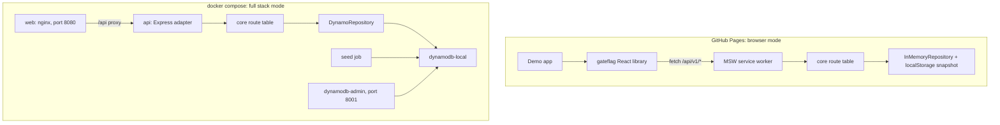

# Build brief: Gateflag

> Paste this whole document into a new Cursor Agent chat, opened in an empty folder called `gateflag`.
> It is the only input you need. There is no other codebase to reference.

---

## 0. How to use this document (instructions for the agent)

You are building **Gateflag** from scratch: a feature-flag and access-control platform made of one API, one React library, and a demo app. It is a **portfolio piece**. Code quality, tests, and the README matter as much as the features.

Work rules:

1. **Work in the phases in section 15, in order.** Create a to-do list with one item per phase. Mark one item in progress at a time.
2. **Each phase ends with a verification command and a commit.** Do not start the next phase until that phase's checks pass.
3. **Commits** follow Conventional Commits (`feat(core): add flag evaluator`). Messages describe technical changes only. Never add AI or tool attribution, `Co-authored-by` trailers, or "generated with" text anywhere: commits, code, docs, or PRs.
4. **Ask me only when blocked.** Otherwise pick the sensible default, note it in `docs/decisions.md` (one line per decision), and keep going.
5. **Never publish to npm or push to GitHub without asking me first.** My npm account is `9spire`. Ask me for my GitHub username when you get to deployment (or run `gh api user --jq .login`).
6. **When reporting progress to me:**
   - Lead with what now works and how to try it (a command or URL).
   - Use numbered steps.
   - Give time estimates in concrete units.
   - Say which phase is done, for example "Phase 3 of 9 done".
   - End with one concrete next action.
   - Skip preambles and recaps.

---

## 1. Elevator pitch

Teams that ship several web apps end up with copy-pasted, per-app feature-flag logic that drifts. **Gateflag** is one service and one drop-in React library that answers "can this user see this feature?" for every app, from a single source of truth.

- Every flag has a **three-state lifecycle**: `DISABLED`, `GATED`, `RELEASED`.
- `GATED` flags are opened to people through roles, groups (optionally time-limited), and individual grants.
- Developers automatically get every gated flag, and admins can switch off a single flag for a single developer.
- An admin console embedded in the host app manages it all.
- The client **fails closed**: if permissions can't be loaded, gated features hide.

Tagline: **"Gateflag: gate features by user, role, and group across every app you ship."**

---

## 2. Goals and non-goals

**Goals:**
- A correct, well-tested evaluation engine (the heart of the project).
- One codebase that runs in two modes:
  - **Browser mode**: the whole API runs inside the browser via Mock Service Worker (MSW), deployed to **GitHub Pages**, $0, no backend.
  - **Full stack mode**: `docker compose up --build` runs the real Express API, DynamoDB Local, and the demo app with no Node install on the host.
- A published React package `gateflag` on npm.
- A demo that teaches the model in 60 seconds: switch personas and watch features lock and unlock.
- A README that reads like a system-design case study.

**Non-goals (out of scope):**
- Real authentication (OIDC, OAuth, passwords). Identity is mocked on purpose (section 7).
- Percentage rollouts, multivariate flags, experiments, or analytics. Flags are boolean.
- Multi-organization tenancy and billing.
- WebSockets or server push. Polling plus event-driven refresh is the design.
- Server-side rendering.
- A real AWS deployment. An optional `infra/` sketch is allowed, never deployed.

---

## 3. Glossary (use these exact terms)

| Term | Meaning |
|---|---|
| **Flag** | A named feature switch. Key format `UPPER_SNAKE_CASE`. |
| **Universal state** | A flag's root state: `DISABLED` (off for everyone, including developers), `GATED` (selective), `RELEASED` (on for everyone). |
| **Role** | Stored on the user: `developer`, `access`, or `none`. |
| **Admin** | A separate privilege (`isAdmin`), not a role. It comes from the identity provider and is never edited in the UI. |
| **Group** | A Gateflag-managed set of users (for example `beta-testers`). It is either evergreen or temporary, with a default TTL in days. |
| **IdP groups** | Groups asserted by the (mock) identity provider on a persona. Used only to decide `isAdmin`. **Not the same as Gateflag groups.** |
| **Grant** | A rule that opens a GATED flag: a role grant (`access` role), a group grant, or a user grant. Group and user grants can expire. |
| **Developer deny** | An admin override that removes one GATED flag from one developer's automatic access. |
| **Access client** | Which host app is asking (for example `storefront`). Sent as the `X-Access-Client` header. Each flag lists the `accessClients` it applies to. |
| **Persona** | A fake signed-in user from `personas.json`, selected in the demo's persona switcher. |

---

## 4. Users and personas

Personas live in `core/src/demo-data/personas.json`:

```json
{
  "adminIdpGroup": "gateflag-admins",
  "personas": [
    { "id": "alex-admin",     "displayName": "Alex",   "email": "alex@example.com",   "idpGroups": ["gateflag-admins"], "blurb": "Admin and developer. Can open the admin console." },
    { "id": "dana-dev",       "displayName": "Dana",   "email": "dana@example.com",   "idpGroups": [],                  "blurb": "Developer. Gets every GATED flag automatically, except BETA_SEARCH, which an admin switched off." },
    { "id": "pat-beta",       "displayName": "Pat",    "email": "pat@example.com",    "idpGroups": [],                  "blurb": "Beta tester with the access role, in the beta-testers group." },
    { "id": "jordan-support", "displayName": "Jordan", "email": "jordan@example.com", "idpGroups": [],                  "blurb": "Support agent in the support-team group." },
    { "id": "sam-none",       "displayName": "Sam",    "email": "sam@example.com",    "idpGroups": [],                  "blurb": "No special access. Sees only RELEASED features." }
  ]
}
```

- The **role** comes from the stored user record (seed data), not the persona, so admins can change it in the UI and the change shows up when you switch to that persona.
- **`isAdmin`** is derived on every request as `persona.idpGroups.includes(adminIdpGroup)`. The stored user's `isAdmin` is synced to match whenever permissions are loaded.

---

## 5. Core user journeys

1. **Visitor explores the demo (browser mode).**
   - Open the Pages URL. A banner reads "Running in browser mode. Data is stored in your browser."
   - The default persona is Sam, so most feature cards show as locked.
   - Switch to Pat: three more cards unlock.
   - The "Why can Pat see this?" panel lists each flag with the reason (for example "Group grant: beta-testers").
2. **Admin releases a flag.**
   - As Alex, click the Access button, go to the Flags tab, and edit `PRODUCT_RECOMMENDATIONS`.
   - Set the state to `RELEASED`. A confirm dialog warns that everyone will get access; confirm.
   - Close the modal, which triggers a refresh. Switch to Sam: the card is unlocked, with reason "Released".
3. **Admin switches off one flag for one developer.**
   - As Alex, open the Users tab, edit Dana, and toggle `NEW_CHECKOUT_FLOW` off in "Developer auto-granted flags".
   - Switch to Dana: that card is locked, with reason "Disabled for this developer by an admin".
4. **Admin grants temporary group access.**
   - As Alex, create the group `launch-crew` as temporary with a 7-day TTL, and add Sam (the default expiry is now plus 7 days).
   - Edit `BETA_SEARCH`, then grant `launch-crew`.
   - Switch to Sam: `BETA_SEARCH` is unlocked, with reason "Group grant: launch-crew".
5. **Emergency off.**
   - As Alex, edit `DARK_MODE` and choose `DISABLED (emergency off)`.
   - Every persona, including developers, loses it.
   - The grants on the flag are preserved and come back if it is set to `GATED` again.
6. **Concurrent edit conflict.**
   - Open the same flag in two tabs, save in tab A, then save in tab B.
   - Tab B gets a toast: "This flag changed since you opened it. Reload to see the latest version." Nothing is overwritten.
7. **Failure: API unreachable (full stack mode).**
   - Stop the `api` container. On the next refresh, every gated feature hides (fail-closed).
   - An unobtrusive error indicator appears. The host app does not crash.
8. **Reset.** "Reset demo" restores the seed data in either mode.
9. **Reviewer runs it locally.**
   - `git clone`, then `docker compose up --build`, then open `http://localhost:8080`. It shows the same demo, backed by the real API and DynamoDB Local.
   - `http://localhost:8001` shows the single table.

---

## 6. Functional requirements

### 6.1 Evaluation algorithm (pure function, in `core`)

`evaluateFlag(flag, ctx, now) => { granted: boolean, reason: Reason }`

`ctx` holds the user's role, active memberships, user grants, developer denies, plus the flag's role grants and group grants. Apply the rules **in this order**:

1. `flag.universalState === 'DISABLED'` gives `{ false, DISABLED }`.
2. `flag.universalState === 'RELEASED'` gives `{ true, RELEASED }`.
3. GATED:
   1. If the role is `developer`: an active deny for this flag gives `{ false, DEVELOPER_DENIED }`; otherwise `{ true, DEVELOPER }`. (Developers never fall through.)
   2. An active user grant gives `{ true, USER_GRANT }`.
   3. An active membership in a group that **still exists** and has an active group grant on this flag gives `{ true, GROUP_GRANT, groupKey }`. If there are several, report the first by `groupKey` alphabetically.
   4. If the role is `access` and the flag has a role grant for `access`, the result is `{ true, ROLE_GRANT }`.
   5. Otherwise `{ false, NO_GRANT }`.

- **Active** means `expiresAt === null || expiresAt > now`. Expiry is always checked in code; DynamoDB TTL is only cleanup.
- `now` is injected, never read from `Date.now()` inside core logic.
- An unknown user evaluates as role `none`, with no grants.

Human-readable reason labels, used by the demo:

| Reason | Label |
|---|---|
| `RELEASED` | Released to everyone |
| `DISABLED` | Disabled for everyone |
| `DEVELOPER` | Automatic: developer role |
| `DEVELOPER_DENIED` | Disabled for this developer by an admin |
| `USER_GRANT` | Individual grant |
| `GROUP_GRANT` | Group grant: {groupKey} |
| `ROLE_GRANT` | Access role grant |
| `NO_GRANT` | No grant |

### 6.2 Access-client scoping

- If an `X-Access-Client` header is present, it must be in `ALLOWED_ACCESS_CLIENTS` (otherwise 400). Only flags whose `accessClients` include that value are evaluated and returned.
- If the header is absent, all flags are evaluated.
- Admin endpoints ignore the header and always return the full catalog. The admin UI filters the list client-side with a "Show flags for" dropdown.
- Default clients: `storefront`, `checkout`, `support-portal`.

### 6.3 Validation and normalization

- **Email**: trimmed, lowercased, and checked against a basic regex. Case-insensitive uniqueness falls out of the lowercasing.
- **Flag key**: input is auto-uppercased, then must match `^[A-Z][A-Z0-9]*(_[A-Z0-9]+)*$`, max 64 characters.
- **Group key**: lowercase kebab case, `^[a-z0-9]+(-[a-z0-9]+)*$`, max 64 characters.
- **Descriptions**: max 500 characters, rendered as text (never as HTML).
- **`accessClients`**: non-empty, each value in the allowlist.
- **`defaultTtlDays`**: `null` (evergreen) or an integer from 1 to 365.
- Validate with **zod** schemas in `core`, shared by the API and the UI forms.

### 6.4 Business rules

1. **Developers cannot be added to groups.** The API returns 422 `BUSINESS_RULE` with the message "Developers have automatic access to all GATED flags and cannot be added to groups." The UI hides developers from member pickers and explains why.
2. **A new flag can only start as `GATED` or `RELEASED`.** `DISABLED (emergency off)` is offered only when editing.
3. **Changing a flag's state never deletes its grants.** The UI hides the grant sections unless the flag is `GATED`.
4. **Changing a flag to `RELEASED` requires a confirm dialog** in the UI: "Everyone will get access, regardless of the grants below."
5. **Admins cannot delete their own user** (422).
6. **`isAdmin` is read-only in the UI.** It shows a badge, "Admin (managed by identity provider)".
7. **Deletes cascade.**
   - Deleting a flag removes all its grants and developer denies.
   - Deleting a group removes all its memberships and grants.
   - Deleting a user removes all their memberships, grants, and denies.
   - Cascades are transactional (section 6.7).
8. **Adding a member with an unknown email auto-creates that user** with role `none`.
9. **A member's default expiry is now plus the group's `defaultTtlDays`**, or never for evergreen groups. A custom expiry must be after now and, for temporary groups, no later than now plus `defaultTtlDays`.
10. **Persona users are provisioned on first load.** If a persona's user record is missing, the permissions request creates it with role `none`.

### 6.5 Optimistic locking

- Users, flags, and groups have an integer `version`, starting at 1.
- Every update request must include `version`. If it doesn't match, the API returns 409 `VERSION_CONFLICT`, and the UI shows the reload toast from journey 6.
- Successful writes increment `version`.

### 6.6 Audit log

- Every admin mutation appends an audit entry: `{ id, at, actorEmail, action, entityType, entityKey, summary }`.
- Example: `summary: "State GATED → RELEASED"`.
- The actor is always the resolved persona's email, never a client-supplied header.
- The Audit tab lists entries newest first, with "Load more" pagination (50 per page).

### 6.7 Transactions

- The DynamoDB repository uses `TransactWriteItems` for cascades. Above 100 items it chunks, and documents in code and in `docs/decisions.md` that chunked cascades are not atomic.
- The in-memory repository applies cascades atomically.

### 6.8 HTTP API (prefix `/api/v1`, JSON)

**Auth levels:** `none`, `user` (requires a valid `X-Demo-User`), `admin` (user, plus `isAdmin`).

| Method | Path | Auth | Purpose |
|---|---|---|---|
| GET | `/health` (no prefix) | none | `{ status: "healthy", timestamp, storage: "memory"\|"dynamo", database: "available"\|"unavailable", apiVersion: "v1" }`. Always 200 if the process is up. |
| GET | `/api/v1/demo/personas` | none | Persona list for the switcher |
| POST | `/api/v1/demo/reset` | none | Reload the seed data. Rate-limited. |
| GET | `/api/v1/permissions` | user | Effective permissions for the **caller** (identity comes from the persona, never from a query param) |
| GET | `/api/v1/check?flag=KEY` | user | `{ flag, hasAccess, reason }` |
| GET | `/api/v1/admin/flags` | admin | List flags |
| GET | `/api/v1/admin/flags/:key` | admin | Flag, plus `roleGrants`, `groupGrants`, `userGrants`, `developerDenies` |
| POST | `/api/v1/admin/flags` | admin | Create `{ key, description, universalState: "GATED"\|"RELEASED", accessClients }` |
| PUT | `/api/v1/admin/flags/:key` | admin | Update `{ description?, universalState?, accessClients?, version }` |
| DELETE | `/api/v1/admin/flags/:key` | admin | Cascade delete |
| POST | `/api/v1/admin/flags/:key/role-access` | admin | `{ role: "access", hasAccess }` |
| POST | `/api/v1/admin/flags/:key/group-access` | admin | `{ groupKey, hasAccess, expiresAt? }` |
| POST | `/api/v1/admin/flags/:key/user-access` | admin | `{ email, hasAccess, expiresAt? }` |
| GET | `/api/v1/admin/users` | admin | List users |
| GET | `/api/v1/admin/users/:email` | admin | User, plus `memberships`, `userGrants`, `developerDenies`, `gatedFlagsWithAccessRole` (keys of GATED flags with an `access` role grant) |
| POST | `/api/v1/admin/users` | admin | Create `{ email, role }` |
| PUT | `/api/v1/admin/users/:email` | admin | `{ role, version }` |
| DELETE | `/api/v1/admin/users/:email` | admin | Cascade delete (not self) |
| POST | `/api/v1/admin/users/:email/deny-flag` | admin | `{ flagKey }` (developers only, GATED flags only) |
| POST | `/api/v1/admin/users/:email/allow-flag` | admin | `{ flagKey }` |
| GET | `/api/v1/admin/groups` | admin | List groups, with member counts |
| GET | `/api/v1/admin/groups/:key` | admin | Group, plus `members`, `flagGrants` |
| POST | `/api/v1/admin/groups` | admin | `{ key, description, defaultTtlDays }` |
| PUT | `/api/v1/admin/groups/:key` | admin | `{ description?, defaultTtlDays?, version }` |
| DELETE | `/api/v1/admin/groups/:key` | admin | Cascade delete |
| POST | `/api/v1/admin/groups/:key/members` | admin | `{ email, expiresAt? }` |
| DELETE | `/api/v1/admin/groups/:key/members/:email` | admin | Remove a member |
| GET | `/api/v1/admin/audit?limit=50&cursor=` | admin | `{ items, nextCursor }` |

- Emails in paths are `encodeURIComponent`-encoded.
- **Permissions response:**

  ```json
  {
    "email": "pat@example.com",
    "role": "access",
    "isAdmin": false,
    "isAdminManagedByIdp": true,
    "flags": ["DARK_MODE", "NEW_CHECKOUT_FLOW", "ORDER_HISTORY_V2", "PRODUCT_RECOMMENDATIONS"],
    "evaluations": {
      "NEW_CHECKOUT_FLOW": { "granted": true, "reason": "GROUP_GRANT", "groupKey": "beta-testers", "universalState": "GATED" }
    },
    "evaluatedAt": "2026-01-01T00:00:00.000Z"
  }
  ```

  `flags` is sorted and contains only granted keys. `evaluations` covers **every** in-scope flag, granted or not.
- **Error shape** (always): `{ "error": { "code": "VALIDATION_ERROR", "message": "...", "details": [...] } }`.

  | Code | Status |
  |---|---|
  | `VALIDATION_ERROR` | 400 |
  | `UNAUTHENTICATED` | 401 |
  | `FORBIDDEN` | 403 |
  | `NOT_FOUND` | 404 |
  | `ALREADY_EXISTS` | 409 |
  | `VERSION_CONFLICT` | 409 |
  | `BUSINESS_RULE` | 422 |
  | `RATE_LIMITED` | 429 |
  | `INTERNAL` | 500, generic message only, no stack traces |

- **Rate limit:** 120 requests per minute per IP on `/api/v1/admin/*` and `/api/v1/demo/reset` (Express only; browser mode has no limit).
- **OpenAPI 3.1:** write the spec by hand in `api/openapi.yaml`, covering every route above. A test asserts that every route in the core route table appears in the spec.

---

## 7. Mock identity (deliberate)

- The client sends **`X-Demo-User: <personaId>`** on every request.
- The server resolves the persona from `personas.json`. An unknown or missing persona gets 401 on `user` and `admin` routes.
- **The server never accepts groups, roles, or admin status from the client.** It trusts only the persona ID, which stands in for "a verified session from a trusted identity provider".
- The persona lookup is a pure function in `core` behind an interface:

  ```ts
  export interface IdentityResolver {
    resolve(headers: Record<string, string | undefined>): ResolvedIdentity | null;
  }
  export interface ResolvedIdentity { personaId: string; email: string; idpGroups: string[]; isAdmin: boolean }
  ```

- The README's **"Auth in this demo"** section explains that a production `IdentityResolver` would verify an OIDC access token (issuer, audience, signature through JWKS) at a trusted backend and read groups from its claims. That is the only change needed, and no other code moves.

---

## 8. Data and domain model

### 8.1 Entities (TypeScript, in `core/src/domain/types.ts`)

```ts
type UniversalState = 'DISABLED' | 'GATED' | 'RELEASED';
type Role = 'developer' | 'access' | 'none';
type ISO = string; // ISO-8601 UTC

interface User { email: string; role: Role; isAdmin: boolean; createdAt: ISO; updatedAt: ISO; version: number }
interface Flag { key: string; description: string; universalState: UniversalState; accessClients: string[]; createdAt: ISO; updatedAt: ISO; version: number }
interface Group { key: string; description: string; defaultTtlDays: number | null; createdAt: ISO; updatedAt: ISO; version: number }
interface Membership { email: string; groupKey: string; expiresAt: ISO | null; addedAt: ISO; addedBy: string }
interface RoleGrant { flagKey: string; role: 'access'; createdAt: ISO }
interface GroupGrant { flagKey: string; groupKey: string; expiresAt: ISO | null; createdAt: ISO }
interface UserGrant { flagKey: string; email: string; expiresAt: ISO | null; createdAt: ISO }
interface DeveloperDeny { flagKey: string; email: string; createdBy: string; createdAt: ISO }
interface AuditEntry { id: string; at: ISO; actorEmail: string; action: string; entityType: 'flag' | 'user' | 'group'; entityKey: string; summary: string }
```

### 8.2 DynamoDB single-table design (table `gateflag`)

- Attributes: `PK`, `SK`, `GSI1PK`, `GSI1SK`, plus `ttl` (epoch seconds, set only on expiring items: expiry plus 1 day; audit entries: plus 90 days).
- Billing: on-demand.

| Entity | PK | SK | GSI1PK | GSI1SK |
|---|---|---|---|---|
| User | `USER#<email>` | `METADATA` | `USERS` | `<email>` |
| Flag | `FLAG#<key>` | `METADATA` | `FLAGS` | `<key>` |
| Group | `GROUP#<key>` | `METADATA` | `GROUPS` | `<key>` |
| Role grant | `FLAG#<key>` | `ROLE#access` | | |
| Group grant | `FLAG#<key>` | `GROUP#<groupKey>` | `GROUP#<groupKey>` | `FLAG#<key>` |
| Membership | `USER#<email>` | `GROUP#<groupKey>` | `GROUP#<groupKey>` | `USER#<email>` |
| User grant | `USER#<email>` | `FLAG#<key>` | `FLAG#<key>` | `USER#<email>` |
| Developer deny | `USER#<email>` | `FLAG_DENY#<key>` | `FLAG#<key>` | `DENY#<email>` |
| Audit | `AUDIT` | `<ISO at>#<id>` | | |

Access patterns, documented in the README with this table:

| Need | Operation |
|---|---|
| Everything about a user (metadata, memberships, grants, denies) | **one** `Query PK = USER#<email>` |
| List users, flags, or groups | `Query GSI1 GSI1PK = USERS/FLAGS/GROUPS` |
| A flag's role and group grants | `Query PK = FLAG#<key>` |
| A flag's user grants and denies | `Query GSI1 GSI1PK = FLAG#<key>` |
| A group's members and flag grants | `Query GSI1 GSI1PK = GROUP#<key>` (split by `GSI1SK` prefix) |
| Audit page | `Query PK = AUDIT, ScanIndexForward = false, Limit 50` |

- Conditional writes: `attribute_not_exists(PK)` on create, and `version = :expected` on update.

### 8.3 Repository interface (`core/src/repository/Repository.ts`)

- Both implementations satisfy one interface: `InMemoryRepository` in `core`, and `DynamoRepository` in `api`.
- They throw typed errors: `NotFoundError`, `AlreadyExistsError`, `VersionConflictError`.
- Required methods:
  - **Users:** `getUser`, `listUsers`, `createUser`, `updateUser(email, patch, expectedVersion)`, `deleteUserCascade`, `getUserBundle(email)` (returns user, memberships, user grants, and denies in one call).
  - **Flags:** `getFlag`, `listFlags`, `createFlag`, `updateFlag`, `deleteFlagCascade`, `getFlagAccess(key)` (role grants, group grants, user grants, denies).
  - **Grants:** `setRoleGrant`, `setGroupGrant(flagKey, groupKey, grant | null)`, `setUserGrant(flagKey, email, grant | null)`, `setDeveloperDeny(email, flagKey, deny | null)`.
  - **Groups:** `getGroup`, `listGroups`, `createGroup`, `updateGroup`, `deleteGroupCascade`, `getGroupDetail(key)` (members and flag grants), `setMembership(groupKey, email, membership | null)`.
  - **Audit and demo:** `appendAudit`, `listAudit({ limit, cursor })`, `resetTo(seed)`.

**Repository contract tests:**
- Write one shared test suite, `runRepositoryContract(name, makeRepo)`, in `core/src/repository/contract.ts`.
- It runs against the in-memory repository always, and against DynamoDB Local when `DYNAMODB_ENDPOINT` is set (always in CI).

### 8.4 Seed data (`core/src/demo-data/seed.json`)

Seed expiries use **relative** `expiresInDays` so the demo never goes stale. The loader converts them to absolute times at load or reset.

```json
{
  "seedVersion": 1,
  "users": [
    { "email": "alex@example.com",   "role": "developer" },
    { "email": "dana@example.com",   "role": "developer" },
    { "email": "pat@example.com",    "role": "access" },
    { "email": "jordan@example.com", "role": "none" },
    { "email": "sam@example.com",    "role": "none" }
  ],
  "groups": [
    { "key": "beta-testers", "description": "External beta program", "defaultTtlDays": 30 },
    { "key": "support-team", "description": "Customer support staff", "defaultTtlDays": null }
  ],
  "memberships": [
    { "email": "pat@example.com",    "groupKey": "beta-testers", "expiresInDays": 30 },
    { "email": "jordan@example.com", "groupKey": "support-team", "expiresInDays": null }
  ],
  "flags": [
    { "key": "NEW_CHECKOUT_FLOW",       "description": "Redesigned one-page checkout",        "universalState": "GATED",    "accessClients": ["storefront", "checkout"] },
    { "key": "PRODUCT_RECOMMENDATIONS", "description": "Personalized product carousel",       "universalState": "GATED",    "accessClients": ["storefront"] },
    { "key": "BETA_SEARCH",             "description": "Semantic search box",                 "universalState": "GATED",    "accessClients": ["storefront", "support-portal"] },
    { "key": "ORDER_HISTORY_V2",        "description": "New order history with tracking",     "universalState": "GATED",    "accessClients": ["storefront", "support-portal"] },
    { "key": "DARK_MODE",               "description": "Dark theme toggle",                   "universalState": "RELEASED", "accessClients": ["storefront", "checkout", "support-portal"] },
    { "key": "BULK_EXPORT",             "description": "CSV export of orders (paused)",       "universalState": "DISABLED", "accessClients": ["support-portal"] }
  ],
  "roleGrants":  [ { "flagKey": "PRODUCT_RECOMMENDATIONS", "role": "access" } ],
  "groupGrants": [
    { "flagKey": "NEW_CHECKOUT_FLOW", "groupKey": "beta-testers", "expiresInDays": null },
    { "flagKey": "ORDER_HISTORY_V2",  "groupKey": "support-team", "expiresInDays": null },
    { "flagKey": "BULK_EXPORT",       "groupKey": "support-team", "expiresInDays": null }
  ],
  "userGrants":  [ { "flagKey": "ORDER_HISTORY_V2", "email": "pat@example.com", "expiresInDays": 7 } ],
  "developerDenies": [ { "flagKey": "BETA_SEARCH", "email": "dana@example.com", "createdBy": "alex@example.com" } ]
}
```

**Golden expectations.** Turn these into a table-driven test in `core`, with `X-Access-Client: storefront`:

| Persona | Granted flags (reason) | Count |
|---|---|---|
| Alex | NEW_CHECKOUT_FLOW, PRODUCT_RECOMMENDATIONS, BETA_SEARCH, ORDER_HISTORY_V2 (DEVELOPER); DARK_MODE (RELEASED) | 5 |
| Dana | NEW_CHECKOUT_FLOW, PRODUCT_RECOMMENDATIONS, ORDER_HISTORY_V2 (DEVELOPER); DARK_MODE (RELEASED). BETA_SEARCH is DEVELOPER_DENIED | 4 |
| Pat | NEW_CHECKOUT_FLOW (GROUP_GRANT beta-testers), PRODUCT_RECOMMENDATIONS (ROLE_GRANT), ORDER_HISTORY_V2 (USER_GRANT), DARK_MODE (RELEASED) | 4 |
| Jordan | ORDER_HISTORY_V2 (GROUP_GRANT support-team), DARK_MODE (RELEASED) | 2 |
| Sam | DARK_MODE (RELEASED) | 1 |

With `X-Access-Client: support-portal`, Jordan gets ORDER_HISTORY_V2 and DARK_MODE. BULK_EXPORT is DISABLED even though support-team has a grant on it.

Also test the time-based cases: at now plus 8 days, Pat's ORDER_HISTORY_V2 reason becomes NO_GRANT, because the user grant has expired and Pat is not in support-team.

---

## 9. Logical architecture



**The key idea: one route table, two adapters.** `core` exports:

```ts
export interface CoreRequest { method: HttpMethod; params: Record<string, string>; query: Record<string, string>; headers: Record<string, string | undefined>; body: unknown }
export interface CoreResponse { status: number; body: unknown }
export interface RouteDef { method: HttpMethod; path: string; auth: 'none' | 'user' | 'admin'; handler: (req: CoreRequest, ctx: HandlerContext) => Promise<CoreResponse> }
export function createRoutes(deps: { repo: Repository; identity: IdentityResolver; clock: () => Date; config: CoreConfig }): RouteDef[];
```

- Paths use `:param` syntax, which both Express 5 and MSW 2 understand.
- **Express adapter** (`api/src/http/expressAdapter.ts`): loops over the routes, registers `app[method](path, ...)`, and maps `req`/`res` to `CoreRequest`/`CoreResponse`. Auth runs inside core, driven by `auth`.
- **MSW adapter** (`demo/src/browser/mswAdapter.ts`): loops over the same routes and registers `http[method]('*' + path, ...)`.
- Core handlers do validation (zod), call services, and map typed errors to the error shape. Express-specific concerns (rate limiting, CORS, JSON parsing, request logging) stay in `api`.

**Layering rules (enforce with ESLint `no-restricted-imports` in `core`):**
- `core` imports nothing from Express, the AWS SDK, React, `node:*`, or DOM APIs.
- Services orchestrate, repositories store, and the evaluator is pure. Handlers stay thin.

**React library refresh model:**
- It fetches permissions on mount and when `userId` or `accessClientId` changes.
- It refetches on window `focus`, on `visibilitychange` to visible, when the admin modal closes, and on a poll interval (default 30 s; `0` disables).
- In-flight requests are deduplicated. Each request carries a sequence number, and stale responses are discarded.
- **Fail-closed:** if a fetch fails, `permissions` becomes `null`, every `useFeatureFlag` returns `false`, `error` is set, and `onError` is called.

**Browser-mode persistence:**
- After every mutation, the in-memory repository snapshot is written to `localStorage` under the key `gateflag:state:v<seedVersion>`.
- On load, a stored snapshot is used if it exists, otherwise the seed. Bumping `seedVersion` invalidates old snapshots.
- "Reset demo" clears the key and reseeds.

---

## 10. Chosen stack

| Concern | Choice |
|---|---|
| Runtime | Node 24 LTS (`.nvmrc`: `24`), npm workspaces |
| Language | TypeScript 5.x, `strict: true`, ESM everywhere |
| Validation | zod |
| API | Express 5, `express-rate-limit`, `cors`, `pino` + `pino-http` logging |
| Storage | `@aws-sdk/client-dynamodb` + `@aws-sdk/lib-dynamodb` (api only); in-memory Maps (core) |
| Frontend | React 19, Vite 6+, Tailwind CSS v4, shadcn/ui (Radix), `sonner` toasts, `lucide-react` icons (import icons individually) |
| Browser API | MSW 2 |
| Library build | `tsup` (ESM and `.d.ts`), Tailwind CLI producing `dist/styles.css` |
| Tests | Vitest everywhere, `@testing-library/react` + jsdom, `supertest`, Playwright (one end-to-end spec) |
| Lint and format | ESLint 9 flat config, `typescript-eslint`, `eslint-plugin-react-hooks`, Prettier |
| Containers | Docker, multi-stage images on `node:24-alpine`, `nginx:alpine` |
| CI/CD | GitHub Actions; GitHub Pages via `actions/deploy-pages` |

**Styling the library without fighting the host app:**
- The `react` package uses Tailwind v4 with the **prefix `gf`** (`@import "tailwindcss" prefix(gf);`), so its classes never collide with the host's.
- It ships compiled CSS at `gateflag/styles.css`, so consumers do not need Tailwind.
- shadcn components are copied into `react/src/ui/` and adjusted to the prefix.
- The admin modal renders in a Radix Dialog portal.

---

## 11. Repository layout

```
gateflag/
├── core/                       @gateflag/core (private): framework-free
│   └── src/
│       ├── domain/             types, zod schemas, evaluator, reason labels
│       ├── services/           permission, flag, user, group, audit services
│       ├── repository/         Repository interface, errors, InMemoryRepository, contract.ts
│       ├── identity/           IdentityResolver + persona resolver
│       ├── http/               createRoutes(), CoreRequest/Response, error mapping
│       └── demo-data/          personas.json, seed.json, seed loader
├── api/                        @gateflag/api (private): Express adapter + DynamoDB
│   ├── src/
│   │   ├── http/               expressAdapter, rate limit, cors, logging
│   │   ├── repository/dynamo/  DynamoRepository, table definition
│   │   ├── scripts/            setup-and-seed.ts (idempotent; waits for DynamoDB)
│   │   └── index.ts            config from env, selects STORAGE=memory|dynamo
│   ├── openapi.yaml
│   └── Dockerfile
├── react/                      gateflag (published): provider, hooks, components, admin modal
│   └── src/
│       ├── api/                PermissionsClient, AdminClient (fetch, typed)
│       ├── context/            AccessControlProvider, refresh logic
│       ├── hooks/              useFeatureFlag, usePermissions, useAccessControl
│       ├── components/         ProtectedFeature, AccessButton, AccessControlErrorBoundary
│       ├── admin/              AdminModal, Flags/Users/Groups/Audit tabs, edit views
│       ├── ui/                 shadcn components (gf prefix)
│       └── styles.css
├── demo/                       @gateflag/demo (private): Vite app
│   ├── src/
│   │   ├── browser/            mswAdapter, localStorage persistence, bootstrap
│   │   ├── storefront/         fake "Acme" pages with gated feature cards
│   │   └── panels/             PersonaSwitcher, AppSwitcher, WhyPanel, TryThis, IntegrationSnippet
│   ├── public/mockServiceWorker.js
│   ├── nginx.conf
│   └── Dockerfile
├── e2e/                        Playwright spec (runs against the browser-mode build)
├── docs/                       decisions.md, architecture.md, screenshots/
├── .github/workflows/          ci.yml, pages.yml
├── docker-compose.yml
├── README.md
└── package.json                workspaces: core, api, react, demo, e2e
```

---

## 12. Demo app specification

**Header**, left to right:
- Gateflag wordmark.
- **App switcher**: Storefront, Checkout, Support portal. This sets `accessClientId`.
- **Persona switcher**: a dropdown with name and blurb, persisted in `localStorage`, defaulting to Sam.
- `<AccessButton label="Admin" />`, visible only to admins.
- "Reset demo" button.
- In browser mode, a slim banner above the header: "Running in browser mode. Data is stored in your browser."

**Main area:**
- A fake "Acme" page for the selected app, with one card per flag in scope.
- Each card is wrapped in `<ProtectedFeature flag="..." fallback={<LockedCard flag="..."/>}>`. The real card shows a plausible mock UI for the feature; the locked card shows a lock icon, the flag key, and "You don't have access".

**Right sidebar:**
1. **"Why can {name} see this?"**: a table of every in-scope flag with its state badge, granted or not, and the human-readable reason.
2. **"Try this"**: a checklist of 4 guided steps (journeys 2 to 5), with checkboxes the visitor can tick.
3. **"Integrate in 3 lines"**: a copyable snippet:

   ```tsx
   <AccessControlProvider config={{ apiBaseUrl: '', userId, accessClientId: 'storefront' }}>
     <ProtectedFeature flag="NEW_CHECKOUT_FLOW"><NewCheckout /></ProtectedFeature>
   </AccessControlProvider>
   ```

**Modes** (set by `VITE_DEMO_MODE`):
- **`browser`**: start MSW before rendering, with `worker.start({ serviceWorker: { url: \`${import.meta.env.BASE_URL}mockServiceWorker.js\` }, onUnhandledRequest: 'bypass' })`.
- **`api`**: plain fetch to the same origin (`apiBaseUrl: ''`). In dev, Vite proxies `/api` and `/health` to `http://localhost:3003`. In compose, nginx proxies them. CORS is never needed.

**Quality:**
- Responsive down to 1024 px wide.
- Keyboard accessible (the Radix defaults).
- Visible focus rings.
- Color is never the only signal; state badges have text.

---

## 13. Admin modal specification (in the `react` package)

Tabs: **Flags, Users, Groups, Audit**.
- Each tab has a search box at the top that filters loaded rows client-side, case-insensitive substring.
- Lists are paginated client-side at 25 rows per page.
- Clicking **Edit** opens a detail view inside the modal with a Back button. Clicking the active tab again returns to its list.

**Flags tab:**
- The list shows key, description, state badge, and access clients.
- "Show flags for" dropdown: All apps, or one app, defaulting to the host's `accessClientId`.

**Flag create and edit view:**
- Key: editable on create only, auto-uppercased as you type, validated inline.
- Description.
- Universal state as a segmented control:
  - On create: GATED or RELEASED.
  - On edit: adds `DISABLED (emergency off)`, styled destructive.
  - Changing to RELEASED requires the confirm dialog.
- Access clients: checkboxes, at least one required.
- **Only when the state is GATED:**
  - "Access role" checkbox.
  - Group checkboxes, each with an optional expiry.
  - Individual users:
    - A read-only "Automatic: developer role" list of developers.
    - A manual grants list: checkboxes over non-developer users, search, an optional permanent or expiry toggle, and an "Apply changes" button that sends the needed calls in parallel.
    - "Add by email" chips: paste comma, space, or newline separated emails; invalid ones are rejected inline.
- Delete button with a confirm dialog.

**Users tab and user edit view:**
- Email: editable on create only.
- Role select.
- The "Admin (managed by identity provider)" badge when relevant.
- Group memberships: add or remove with an optional expiry. For developers, this section is disabled with an explanation.
- **If the role is `developer`:** a "Developer auto-granted flags" list of GATED flags with on/off toggles (deny and allow).
- **Otherwise:** "Individual flag grants" for GATED flags only.
  - Flags granted through the access role show as checked and read-only, with an "Access role" badge, unless an individual grant also exists; then only the individual grant can be removed.
  - Changing the role dropdown updates this display before save.
- Delete with confirm, disabled for self.

**Groups tab and group edit view:**
- Key, editable on create only.
- Description.
- Evergreen or Temporary, with a days input.
- Members:
  - A checkbox list of all non-developer users, with search, "Current member" badges, and expiry shown inline.
  - "Use group default expiry" checkbox, otherwise a `datetime-local` input with `min` = now and `max` = now plus TTL.
  - "Add by email" chips.
- Flag grants list.
- Delete with confirm.

**Audit tab:**
- Newest first, with time (relative plus absolute on hover), actor, action, entity, and summary.
- "Load more" button.

**Everywhere:**
- Success and error toasts, auto-dismissed after 5 s.
- Buttons show loading state, and loading always clears, even on error (`try/finally`).
- A 409 conflict shows the reload toast.

---

## 14. Configuration and environment

| Variable | Where | Purpose | Example |
|---|---|---|---|
| `PORT` | api | HTTP port | `3003` |
| `STORAGE` | api | `memory` or `dynamo` | `dynamo` |
| `DYNAMODB_ENDPOINT` | api, tests | DynamoDB Local URL (unset means real AWS) | `http://dynamodb-local:8000` |
| `DYNAMODB_TABLE_NAME` | api | Table name | `gateflag` |
| `AWS_REGION` | api | Required by the SDK | `us-east-1` |
| `AWS_ACCESS_KEY_ID` / `AWS_SECRET_ACCESS_KEY` | api (local only) | Dummy values for DynamoDB Local | `local` |
| `ALLOWED_ACCESS_CLIENTS` | api | Comma-separated allowlist | `storefront,checkout,support-portal` |
| `ALLOWED_ORIGINS` | api | CORS allowlist (only needed if not same-origin) | `http://localhost:5173` |
| `LOG_LEVEL` | api | pino level | `info` |
| `VITE_DEMO_MODE` | demo build | `browser` or `api` | `browser` |
| `VITE_BASE_PATH` | demo build | Vite `base` | `/gateflag/` for Pages, `/` otherwise |

- Commit `api/.env.example` and `demo/.env.example`.
- Never commit `.env`.
- There are no real secrets anywhere in this project.

---

## 15. Phases (do them in order)

Time estimates assume an agent doing the work with me reviewing. Each phase ends with **Verify** and **Commit**.

### Phase 1: Repo scaffold (about 30 minutes)

- `git init`. Add the npm workspaces `core`, `api`, `react`, `demo`, `e2e`.
- Add `.nvmrc`, a root `tsconfig.base.json` (strict, ESM, `moduleResolution: bundler`), and project references.
- Add the ESLint flat config (including the `core` import restrictions), Prettier, `.gitignore`, `.editorconfig`, and an MIT `LICENSE`.
- Root scripts: `lint`, `typecheck`, `test`, `build`, `format`, `dev`, `dev:browser`.
- Add a README stub and `docs/decisions.md`.
- **Verify:** `npm ci && npm run lint && npm run typecheck` pass.

### Phase 2: Core domain and evaluator (about 3 hours)

- Write the types, zod schemas, `evaluateFlag`, reason labels, and the seed loader (relative to absolute expiries).
- Tests:
  - Every reason path.
  - The order of precedence.
  - Expiry boundaries (equal to now counts as expired).
  - The golden persona table (section 8.4).
  - Access-client filtering.
  - The plus-8-days case.
- **Verify:** `npm test -w core`, with coverage at least 95% on `domain/`.

### Phase 3: Repository, services, routes (about 5 hours)

- Write the `Repository` interface, typed errors, `InMemoryRepository`, and `runRepositoryContract`.
- Write the services with every business rule from section 6.4, optimistic locking, audit, and cascades.
- Write `createRoutes`, the persona `IdentityResolver`, and the error mapping.
- Tests:
  - The contract suite on in-memory.
  - Service rule tests.
  - Route-level tests that call handlers directly: 401, 403, 409, 422, and the happy paths.
- **Verify:** `npm test -w core`.

### Phase 4: Express API and DynamoDB (about 4 hours)

- Write the Express adapter, `/health`, rate limiting, pino logging (redact `x-demo-user`), and config from env.
- Write `DynamoRepository` to the table design in section 8.2, including transactions and chunked cascades.
- Write `setup-and-seed.ts`: create the table and GSI if missing, wait until it is ACTIVE, retry the connection for up to 60 s, seed if empty.
- Write the `api/Dockerfile`: multi-stage, build context is the repo root, runtime `node:24-alpine`, non-root user. The health check uses `wget` (alpine has no `curl`).
- Write `openapi.yaml`, plus a test that every route is documented.
- Tests: supertest against `STORAGE=memory`; the contract suite against DynamoDB Local (start it with `docker run -p 8000:8000 amazon/dynamodb-local`).
- **Verify:** `npm test -w api` (with `DYNAMODB_ENDPOINT` set), and `curl localhost:3003/health`.

### Phase 5: React library core (about 4 hours)

- Write `PermissionsClient` and `AdminClient` (typed, sending `X-Demo-User` and `X-Access-Client`).
- Write `AccessControlProvider` with the full refresh model and fail-closed behavior.
- Write the hooks, `ProtectedFeature`, `AccessButton` (renders `null` unless `isAdmin`; optional `label` and `onClose`), and `AccessControlErrorBoundary` (`fallback`, `onError`).
- Config type:

  ```ts
  interface AccessControlConfig {
    apiBaseUrl: string;                 // '' = same origin
    userId: string | null;              // persona id; null = signed out (everything fails closed, no requests)
    accessClientId?: string;
    pollIntervalMs?: number;            // default 30000; 0 disables
    getAuthHeaders?: () => Record<string, string> | Promise<Record<string, string>>; // default: { 'X-Demo-User': userId }
    onError?: (error: Error) => void;
  }
  ```

- Tests (Vitest + Testing Library; use MSW in Node **with the core route table and the in-memory repository**, so the tests hit real logic):
  - Fail-closed on 500 and on network error.
  - Refresh on focus and on visibility change.
  - Refresh on identity change.
  - A stale response is ignored.
  - `ProtectedFeature` renders its fallback.
  - `AccessButton` is hidden for non-admins.
- **Verify:** `npm test -w react`.

### Phase 6: Admin modal UI (about 8 hours)

- Set up Tailwind v4 with the `gf` prefix and shadcn components in `react/src/ui`.
- Build everything in section 13.
- Build the package with `tsup` and the Tailwind CLI. `package.json` needs:
  - `exports` for `.` and `./styles.css`, and `files: ["dist"]`.
  - `peerDependencies`: `react` and `react-dom` `^18 || ^19`.
  - `sideEffects: ["*.css"]`.
- Tests: create a flag; the RELEASED confirm dialog; the 409 toast; developer toggles; developers excluded from group member pickers; key auto-uppercase; email chip parsing.
- **Verify:** `npm test -w react && npm run build -w react`, then inspect `react/dist` (ESM, `.d.ts`, `styles.css`).

### Phase 7: Demo app, both modes (about 4 hours)

- Build everything in section 12.
- Browser mode: the MSW adapter and `localStorage` snapshot persistence. Run `npx msw init demo/public --save`.
- API mode: the Vite proxy.
- Scripts:
  - `npm run dev`: API with `STORAGE=memory`, plus the demo in API mode, with the library source aliased for hot reload.
  - `npm run dev:browser`: the demo in browser mode, no API.
- **Verify:** walk journeys 1 to 6 manually in both modes and take screenshots into `docs/screenshots/`.

### Phase 8: Docker Compose full stack (about 2 hours)

Services:

| Service | Image or build | Ports | Notes |
|---|---|---|---|
| `dynamodb-local` | `amazon/dynamodb-local:2.5.2`, `-jar DynamoDBLocal.jar -sharedDb -inMemory` | 8000 | |
| `dynamodb-admin` | `aaronshaf/dynamodb-admin` | 8001 | `DYNAMO_ENDPOINT=http://dynamodb-local:8000` |
| `seed` | api image, `node api/dist/scripts/setup-and-seed.js` | | `restart: "no"`, depends on `dynamodb-local` (it retries the connection itself) |
| `api` | `api/Dockerfile`, `STORAGE=dynamo` | 3003 | `depends_on: seed: condition: service_completed_successfully`; healthcheck `wget -qO- http://localhost:3003/health` |
| `web` | `demo/Dockerfile`: Vite build with `VITE_DEMO_MODE=api`, then `nginx:alpine` | 8080 | `depends_on: api: condition: service_healthy` |

- `nginx.conf`: `location /api/` and `location /health` proxy to `http://api:3003`; `location /` uses `try_files $uri /index.html`.
- Container names: `gateflag-dynamodb-local`, `gateflag-dynamodb-admin`, `gateflag-seed`, `gateflag-api`, `gateflag-web`.
- "Reset demo" in DynamoDB mode deletes all items with Scan plus batch delete, then reseeds.
- **Verify:** `docker compose up --build --wait`, then:
  - `curl -fsS localhost:8080/health`.
  - `curl -fsS -H 'X-Demo-User: sam-none' -H 'X-Access-Client: storefront' localhost:8080/api/v1/permissions`, and check that it returns exactly `["DARK_MODE"]`.
  - `docker compose down`.

### Phase 9: CI, Pages, end-to-end test, docs, publish (about 4 hours)

- **`.github/workflows/ci.yml`** (on PRs and pushes to `main`):
  1. A **verify** job: `npm ci`, lint, typecheck, test (with a `dynamodb-local` service container and `DYNAMODB_ENDPOINT` set), build.
  2. A **compose-smoke** job: the Phase 8 verify commands.
  3. An **e2e** job: build the demo in browser mode, run `vite preview`, run the Playwright spec. The spec: as Sam, `PRODUCT_RECOMMENDATIONS` is locked; switch to Alex, open Admin, release it, confirm, close; switch to Sam, and it is unlocked.
- **`.github/workflows/pages.yml`** (on push to `main`):
  - Build the demo with `VITE_DEMO_MODE=browser` and `VITE_BASE_PATH=/gateflag/`.
  - `cp dist/index.html dist/404.html`.
  - `actions/upload-pages-artifact`, then `actions/deploy-pages`, with `permissions: pages: write, id-token: write`.
  - Tell me to set the repo's Settings, Pages, Source to "GitHub Actions".
- **README.md** (portfolio quality), in this order:
  1. Title and tagline, live demo link, and a GIF of switching personas (record it, or tell me exactly what to record).
  2. "Try it in 30 seconds": the Pages link, then `docker compose up --build`.
  3. The problem it solves.
  4. The three-state model and the evaluation order (a diagram).
  5. Architecture: one route table, two adapters (the section 9 diagram).
  6. The single-table DynamoDB design, with the entity and access-pattern tables.
  7. React integration (3 lines) and the refresh and fail-closed model.
  8. **Auth in this demo** (section 7 wording).
  9. Engineering decisions and trade-offs: optimistic locking, transactional cascades and their 100-item limit, expiry checked in code, client gating as UX rather than security (sensitive actions must be enforced server-side), polling instead of push.
  10. Testing strategy: the golden persona table, repository contract tests on both stores, MSW with real handlers, end-to-end.
  11. Local development and the scripts.
- **`docs/architecture.md`**: a deeper write-up for interviews, covering talking points, scaling notes (per-flag grant queries, caching, a hot audit partition), and what changes for production.
- **npm:**
  - Prepare `react/package.json` as `name: "gateflag"`, `version: "0.1.0"`, with `license`, `repository`, `keywords`, and a package README.
  - Run `npm pack --dry-run -w react` and show me the file list.
  - **Ask me before running `npm publish --access public -w react`.**

---

## 16. Quality bar

- **TypeScript strict**, with no `any` unless commented why. No unused exports.
- **Pure versus impure:** I/O lives in thin adapters, and decisions live in pure functions in `core`.
- **Errors:** typed errors in `core`, mapped once at the HTTP boundary. Never leak stack traces.
- **Logging:** structured pino logs with a request ID. Never log the `X-Demo-User` header value in production mode.
- **Tests:** described above. Every phase leaves `npm test` green. Coverage: `core` at least 90%, `react` at least 80% (reported in CI).
- **Accessibility:** every control is labeled and the modal traps focus (Radix). Check the demo with an axe pass in the Playwright spec (no serious violations).
- **Bundle:** the `gateflag` package has React as a peer only. `lucide` icons are imported individually. Report the package's gzipped size in the README.
- **Docs:** README, `docs/architecture.md`, `docs/decisions.md`, `openapi.yaml`, and the `.env.example` files.

---

## 17. Acceptance criteria (definition of done)

- [ ] `npm ci && npm run lint && npm run typecheck && npm test && npm run build` passes from a clean clone.
- [ ] The golden persona table test passes against both the in-memory and DynamoDB repositories.
- [ ] `docker compose up --build --wait` brings the stack up healthy on a machine with only Docker installed. `http://localhost:8080` shows the demo, and `http://localhost:8001` shows the table.
- [ ] `curl -H 'X-Demo-User: sam-none' -H 'X-Access-Client: storefront' localhost:8080/api/v1/permissions` returns `flags: ["DARK_MODE"]`.
- [ ] A request without `X-Demo-User` to `/api/v1/permissions` returns 401. Pat calling `/api/v1/admin/flags` returns 403.
- [ ] Journeys 1 to 8 work in browser mode on the GitHub Pages URL, and journeys 1 to 9 work in compose mode.
- [ ] Browser-mode changes survive a page refresh, and "Reset demo" restores the seed.
- [ ] Stopping the `api` container makes gated features hide within one refresh cycle, and the page does not crash.
- [ ] The concurrent edit in two tabs produces a 409 conflict toast, and no data is lost.
- [ ] The Playwright end-to-end spec and the axe check pass in CI.
- [ ] The README has a live demo link, the GIF, the architecture and table diagrams, and the "Auth in this demo" section.
- [ ] `npm pack --dry-run -w react` shows only `dist/`, `README.md`, `LICENSE`, and `package.json`.
- [ ] No secrets, real emails, or company names anywhere in the repo or its git history.

---

## 18. Assumptions and open questions

**Assumptions** (proceed with these unless I say otherwise):
- The GitHub repo is named `gateflag` and is public, so the Pages URL is `https://<github-user>.github.io/gateflag/`.
- The license is MIT.
- Flags are boolean only.
- English only.

**Open questions** (ask me when you reach them; don't block earlier phases):
1. My GitHub username (Phase 9).
2. Whether to publish `gateflag@0.1.0` to npm now, or only claim the name with `0.0.1` (Phase 9).
